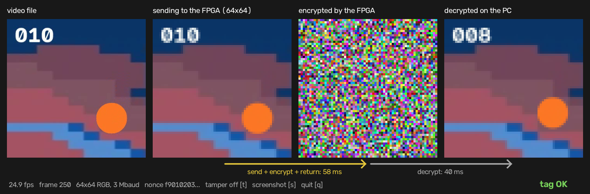

# Image Encryption Accelerator

**Ascon-AEAD128 image encryption in hardware, written as Chisel generators and running on a Digilent Nexys A7-100T FPGA.**

The PC sends an image (or a live camera feed) over USB. The FPGA encrypts the pixels on the fly while they stream through it and sends back the ciphertext with a 128-bit authentication tag. The PC decrypts and verifies the result with the official Ascon reference implementation.



*Live 64x64 video at ~20 fps. From left to right: the camera right now, the frame that went to the FPGA, what the FPGA sent back, and that frame decrypted on the PC (shown only because the tag matched). The last three show the same frame; it is a little behind the live camera because of the trip through the board.*

> Course project for *Hardware Chip Design* (2026). This README is the project report: it explains what we
> built, why we built it this way, how to run it and what we measured.

**Just want to see it run?** Go to [8.1 Quick start](#81-quick-start-about-5-minutes).

---

## Contents

1. [Summary](#1-summary)
2. [The problem](#2-the-problem)
3. [Goals and what we delivered](#3-goals-and-what-we-delivered)
4. [Background: Ascon-AEAD128 in one page](#4-background-ascon-aead128-in-one-page)
5. [Design decisions](#5-design-decisions)
6. [Architecture](#6-architecture)
7. [Verification](#7-verification)
8. [How to run it](#8-how-to-run-it)
9. [Results and evaluation](#9-results-and-evaluation)
10. [How we developed it](#10-how-we-developed-it)
11. [Limitations and future work](#11-limitations-and-future-work)
12. [Repository layout](#12-repository-layout)
13. [Appendix: byte order](#13-appendix-byte-order)
14. [Team](#14-team)
15. [References](#15-references)

---

## 1. Summary

| | |
|---|---|
| Algorithm | Ascon-AEAD128 (NIST SP 800-232): 128-bit key, nonce and tag |
| Hardware | Chisel 6 generators, SystemVerilog generated with CIRCT, Vivado 2023.2 |
| Board | Digilent Nexys A7-100T, Artix-7 `xc7a100tcsg324-1`, 100 MHz |
| Image formats | any width x height, RGB or grayscale, chosen when the hardware is generated |
| Area | ~1150 LUTs per encryption lane, **about 2% of the FPGA**; no block RAM |
| Timing | met at 100 MHz with 2.5 ns of slack on the board design |
| Speed of the logic | 90 MB/s per lane at 100 MHz |
| Speed on the board | 256x256 RGB image in **0.67 s**; live 64x64 RGB video at **~20 fps** |
| Bottleneck | the USB-UART link, ~300x slower than the encryption logic |
| Verification | chiseltest against `pyascon` test vectors; every board result checked byte for byte |

## 2. The problem

Images carry private information: medical scans, camera feeds, documents. Encrypting them is not as
simple as it looks. With a naive block cipher mode (ECB), identical blocks of pixels encrypt to
identical ciphertext, so the outline of the picture stays visible in the "encrypted" image. Encryption
also costs time and energy, which matters for small devices such as cameras and sensors that send images
all day.

We wanted an accelerator that:
- encrypts an image while it streams through, without storing it;
- leaves **no visible structure** in the encrypted image;
- also **authenticates** it, so any change on the way is detected;
- is small enough for a cheap FPGA and can be reshaped (image size, colour, parallelism) without
  rewriting the hardware.

## 3. Goals and what we delivered

The plan at the start of the course (see `docs/scrum.md`) and where we ended:

| Planned | Status |
|---|---|
| Ascon permutation and encryption core in Chisel | done, matches the reference |
| Stream a 128x128 grayscale image through the core in simulation (MVP) | done, demo on 2026-10-27 |
| Software decryption recovers the image exactly | done |
| Colour images | done: RGB and grayscale, any size, as generator parameters |
| Several images at once | done: one independent lane per image |
| Load the image over UART on the Nexys A7 | done, up to 3 Mbaud |
| Rounds-per-cycle parameter, synthesis results per setting | done: 1, 2 and 4 rounds per cycle evaluated |
| Decryption on the FPGA | not done, the PC decrypts (see [future work](#11-limitations-and-future-work)) |
| *Extra:* live camera video through the FPGA | done, ~20 fps |
| *Extra:* progress bar and image counters on the board | done |

## 4. Background: Ascon-AEAD128 in one page

Ascon is the lightweight cipher standardised by NIST in 2025 (SP 00-232). It is an **authenticated encryption** scheme: besides hiding the data, it roduces a tag that proves the data was not changed.

**State.** 320 bits as five 64-bit words `x0 .. x4`.

**Permutation round.** Three steps, only XOR, AND, NOT and rotations which is why it maps so well to hardware:
1. *Constant addition:* a round constant is XORed into `x2`.
2. *Substitution layer:* a 5-bit S-box applied to every bit column of the five words.
3. *Linear diffusion layer:* each word is XORed with two rotated copies of itself.

**Encryption of a message.**
```
 key, nonce ──► [ init: 12 rounds ] ──► for every 16-byte block:          ──► [ final: 12 rounds ] ──► tag
                                          ciphertext = block XOR (x0,x1)
                                          (x0,x1) = ciphertext
                                          8 rounds
```

The ciphertext is the plaintext XORed with bytes that come out of the state (a keystream). Those bytes depend on the key **and the nonce**, which is why:
- the encrypted image looks like noise, even for a black image (black = zeros, and zero XOR keystream = keystream);
- the same image with a new nonce gives completely different noise;
- **a nonce must never be used twice with the same key**: otherwise XORing two ciphertexts cancels the keystream and leaks the difference between the two images.

The nonce is not secret, so it can be sent along with the ciphertext. The key is secret.

## 5. Design decisions

### 5.1 Ascon, not AES
AES is the most common encryption algorithm and frequently used in dedicated cryptoprocessors, but it needs large S-box tables and key expansion. Ascon is the new NIST lightweight standard, uses only bitwise operations on a 320-bit state and gives authentication for free.
It is small in hardware and a better fit for small devices like FPGAs.
**Ascon-AEAD128 as in SP 800-232**.

### 5.2 Chisel generators instead of fixed RTL
The course is about hardware generators, and the questions we wanted to explore (image size, colour, number of lanes, rounds per clock cycle) are a perfect fit for chisel parameters. One Scala call gives a different circuit:

```scala
new Top(width = 256, height = 256, channels = 3, numImages = 1)   // 256x256 RGB, one lane
new Top(64, 64, 1, numImages = 4, roundsPerCycle = 2)            // 64x64 grayscale, four lanes, 2 rounds per cycle
new BoardTop(64, 64, 3, baudRate = 3000000, echo = false)        // the video bitstream
```

The tests live in the same code base and run against the same generators.

### 5.3 Stream, do not store

The core never holds the image. Pixels come in, are grouped into 16-byte blocks, encrypted and sent out. So **the area does not depend on the resolution**: a 64x64 and a 3840x2160 image use the same circuit, only a counter is wider. No block RAM is needed.

### 5.4 Ready/valid byte streams between modules

Every module talks through Chisel's `Decoupled` (ready/valid) interface. A module only moves data when both sides agree, so modules with different speeds (UART, packer, core) can be chained without extra timing logic, and each one can be tested on its own. The MVP started with a pass-through engine with the same interface, which let the rest of the pipeline be built and tested before the Ascon core existed.

### 5.5 Colour as bytes in the same stream

An RGB pixel becomes three bytes R, G, B in the same 8-bit stream that grayscale uses. The core does not know about colour at all: `PixelFormatter` decides how many bytes a pixel gives. RGB and grayscale share
every other module.

### 5.6 One lane per image

To encrypt several images at once we replicate the whole path (formatter, packer, core, unpacker) once per image instead of sharing one core. Each lane has its own stream and its own nonce. It is simple, it scales linearly and the evaluation shows ~43 lanes fit on the FPGA.

### 5.7 One round per clock cycle

We expected that doing more permutation rounds per cycle would make the accelerator faster. We built a `roundsPerCycle` parameter (1, 2 or 4: they must divide both 12 and 8, the round counts of Ascon) and measured it (section 9.4). More rounds per cycle make the core need fewer cycles, but the circuit gets bigger and its clock slower; with 4 rounds per cycle it does not reach 100 MHz. For the whole design **1 round per cycle wins** on area, clock, latency, power and efficiency, so it is the default.

### 5.8 UART, not SD card

The board offers a USB-UART bridge and a microSD slot. We chose the UART: it needs no file system, the same cable also programs the board, and it allows a live demo with the PC in the loop. Its cost is speed, which the evaluation shows clearly.

- The standard 115 200 baud needs 17 s per 256x256 image. The FTDI chip on the board accepts up to **3 Mbaud**, which gives 0.67 s.
- **The board transmits 1% faster than it receives.** With exactly the same rate on both sides, tiny clock differences slowly filled the receive queue until bytes were lost (we saw this at 2 Mbaud). The receiver on the PC samples in the middle of each bit, so 1% is well within what it tolerates.
- A 256-byte queue sits between the UART receiver and the core to cover the moments the core is busy.
- On the PC, sending and receiving run in two threads at the same time (full duplex). Reading only after writing lost data, because the board answers while the image is still arriving.
- **The board resets itself for 256 clock cycles after programming.** Right after programming, the registers do not all start at their reset value: Vivado had mapped the transmitter's idle bit to a flip-flop that starts at 0, so the TX line stayed low and the PC lost the first byte. A small counter without reset holds the rest of the design in reset until it has counted to 255.

### 5.9 A new nonce for every image, sent with the ciphertext

The board starts from a fixed nonce and adds one after every image. It sends the 16 nonce bytes before each ciphertext, so the PC always knows which nonce to decrypt with. The nonce is only sent once the first byte of that image has arrived, so the PC is already listening.

### 5.10 PC tools in Python, checked with the official reference

The hardware is all Chisel. The PC side (sending images, decrypting, the video window) is written in Python because it has ready libraries for the serial port, images and the camera, and because it lets us decrypt with **`pyascon`, the reference implementation by the Ascon designers**. If the PC used our own Scala Ascon, a mistake shared by both could go unnoticed; an independent reference cannot share our bugs.

### 5.11 Little-endian everywhere

Ascon-AEAD128 defines byte 0 as the least significant byte. We use that order everywhere (key, nonce, data, tag), so the core needs no byte swapping. See the [appendix](#13-appendix-byte-order).

## 6. Architecture


## 7. Verification


## 8. How to run it

```
sbt run                                 # uses assets/128x128-pixel-art.jpg, 256x256 RGB
sbt "run path/to/image.png"             # any other image, 256x256 RGB
sbt "run path/to/image.png 128 96 rgb"  # width, height and gray or rgb
sbt "run path/to/image.png 64 64 gray"  # the MVP format, the fastest to simulate
sbt "run a.png,b.png 128 128 rgb"       # several images at the same time
```

The hardware is generated for one image format and number of images:
`Top(width, height, channels, numImages)`, with 1 channel for grayscale and 3 for
RGB. Its input is always one 24-bit RGB pixel per transfer. `PixelFormatter` turns
it into the bytes R, G, B or into one grayscale byte. The core has no padding yet,
so `width * height * channels` must be a multiple of 16 bytes. Any size with both
sides a multiple of 4 works.

`numImages` gives one independent `ImageLane` per image (PixelFormatter -> Packer
-> Ascon -> Unpacker), with its own stream and its own nonce, all with the same key.

1. `ImageFile` (on the PC) reads each image and scales it to that size.
2. The pixels go through `Top` in simulation, with the fixed MVP key and nonce
   (bytes `00 01 … 0f`). Image `i` uses that nonce + `i`, a nonce must never repeat
   with the same key.
3. The ciphertext is turned back into an image, the 16-byte tag is saved apart.
4. The Verilog of `Top` is written to `generated/Top.sv`.

Results in `output/`: `original.png`, `image.bin` (the bytes that were encrypted),
`encrypted.png`, `encrypted.bin` and `tag.bin`. With several images the names end
in `_0`, `_1`, ...

## 9. Results and evaluation

_Written in a later pull request._

## 10. How we developed it

_Written in a later pull request._

## 11. Limitations and future work

_Written in a later pull request._

## 12. Repository layout

```
src/main/scala/engine/   Chisel hardware: Ascon, Top, PixelFormatter, Packer, UART, BoardTop
                         and the Scala programs (Main: simulation pipeline, BoardMain, RoundsSweep, LanesSweep)
src/test/scala/engine/   chiseltest specs, checked against pyascon values
fpga/                    nexys_a7.xdc (pins), build.tcl, program.tcl, ooc.tcl (Vivado in batch mode)
bitstreams/              ready bitstreams for the board (images and video)
tools/                   PC side in Python: program, send_images, decrypt, video, bench, ascon.py (pyascon)
evaluation/              measured data (data/), the graphs (graphs/) and the scripts that draw them
docs/                    Ascon specification, project idea, Scrum plan, images for this README
scrum/                   sprint reviews and retrospectives
assets/                  test images
generated/, output/      written by the tools, not in git
```

## 13. Appendix: byte order

All multi-byte values are little-endian, as in Ascon-AEAD128 (SP 800-232): byte 0 is in bits 7..0. In
Chisel that is what `Vec(bytes).asUInt` gives; in Python, `int.from_bytes(b, "little")`. The core has no
byte-swapping logic.

| Value | Width | Format |
|---|---|---|
| Key, nonce | 128 bit | 16 bytes as one little-endian integer |
| Data block | 128 bit | 16 bytes; bytes 0..7 go into `x0`, bytes 8..15 into `x1` |
| Tag | 128 bit | `x3` (bytes 0..7) and `x4` (bytes 8..15) after finalisation, XORed with the key |

**Stream order:** pixels row by row, top-left first; for RGB, R then G then B.

**Example.** Key = nonce = bytes `00 01 .. 0f`:

```
io.key = 0x0f0e0d0c0b0a09080706050403020100
x1     = 0x0706050403020100   (key bytes 0..7)
x2     = 0x0f0e0d0c0b0a0908   (key bytes 8..15)
```

For the plaintext bytes `00 .. 1f` the tag is `a28657f6e82fe53d08b09eff9330bd2b`.

**In Python:**

```python
key_int = int.from_bytes(key_bytes, "little")
blocks  = [int.from_bytes(data[i:i + 16], "little") for i in range(0, len(data), 16)]
```

## 14. Team

_Written in a later pull request._

## 15. References

_Written in a later pull request._

