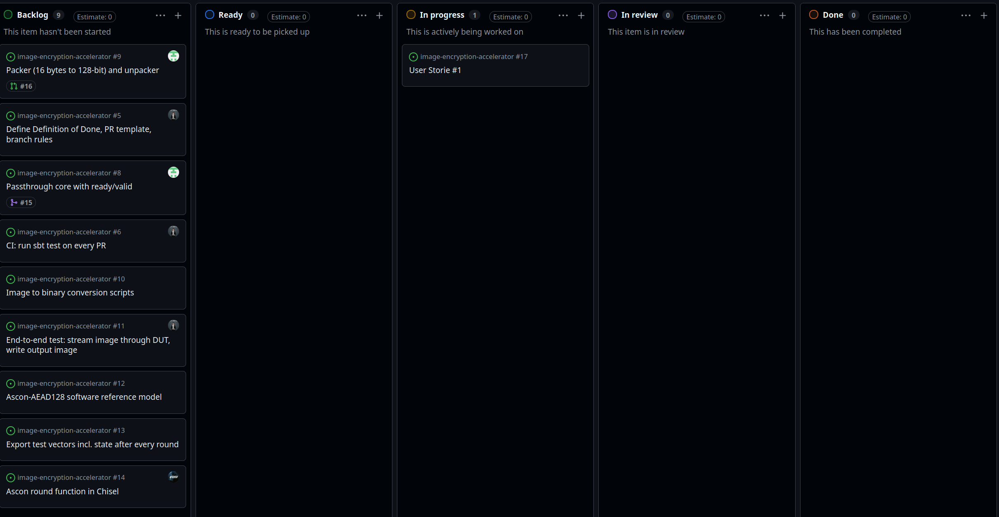

# Sprint 1

## Dates

2026-09-29 - 2026-10-06

## Management info
### Sprint Planning Meeting: 
Discussions about topic to choose, User Stories, MVP, CI,research tasks about MVP with building the presentation included.  

### Sprint Review and Retrospective Meeting: 
This week we had less time to focus on the project due to other events. We changed slightly the user story, and we assigned the tasks.
Next week we will start to work on the tasks slightly and still work more on the structure of the MVP.
## Relevant resources

### Scrum Board at the beginning of the sprint

EMPTY

### Scrum Board at the end of the sprint

