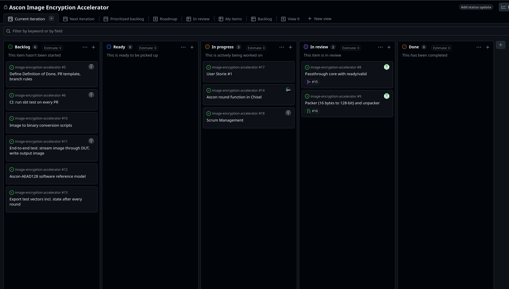
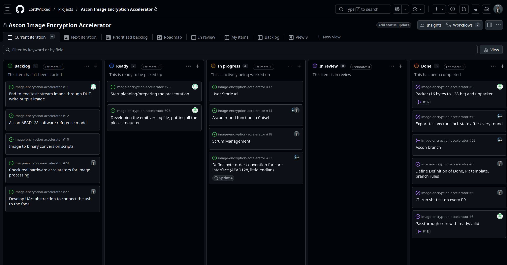

# Sprint 3

## Dates

2026-10-13 - 2026-10-20

## Management info
### Sprint Planning Meeting: 
Discussions about implementing the ascon algorithm, how to procede with the conversion from image to the bytes. Furthermore, define dates to start preparin into the MVP presentation and split tasks to finish it.

### Sprint Review and Retrospective Meeting: 
We've splitted the tasks accordingly, solved the problem of which type of ascon to use. Also talked about the testing implementation for the MVP and defined the next Milestone (try to see how after the MVP how much computing does the FPGA handles and try to optimize as much as possible.)

## Relevant resources

### Scrum Board at the beginning of the sprint

### Scrum Board at the end of the sprint

### Burndown Chart for the sprint

EMPTY

### Gantt Chart

EMPTY
