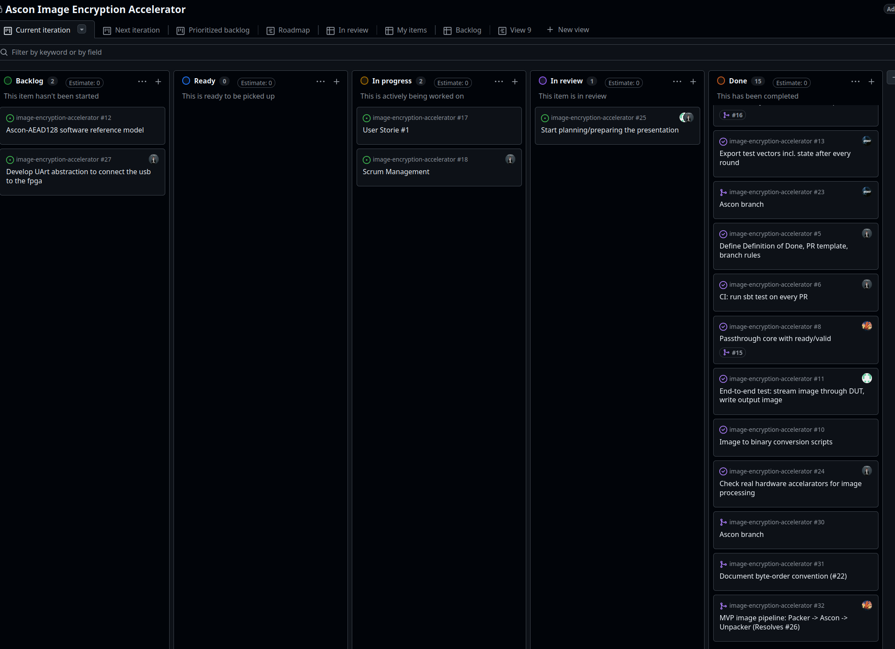

# Sprint 3

## Dates

2026-10-20 - 2026-10-27

## Management info
### Sprint Planning Meeting: 
Discussions about whether demonstrating the MVP live or just in slides. What type of data would we need 
to show in the presentation (burndown chart for instance). Ascon changes and ways to optimize it in the future.

### Sprint Review and Retrospective Meeting: 
We focused on finishing Ascon algorithm and putting the pipeline working accurately. Also the way 
of doing the 10 min presentation and what was relevant to show. We figure it out that we needed first to 
show the problem related to encrypting images and after that we provided the solution. Also talked about
efficiency in the fpga and what we need to do after MVP

## Relevant resources

### Scrum Board at the beginning of the sprint

### Scrum Board at the end of the sprint

### Burndown Chart for the sprint

EMPTY

### Gantt Chart

EMPTY
