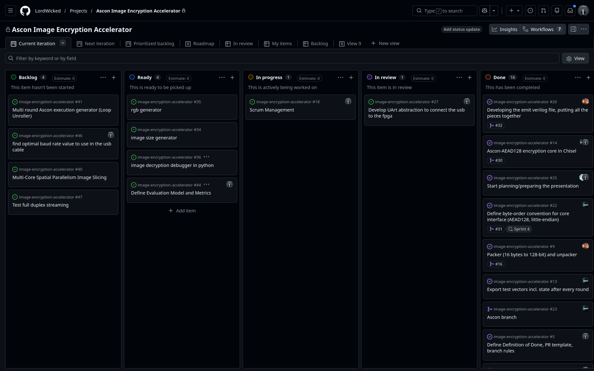
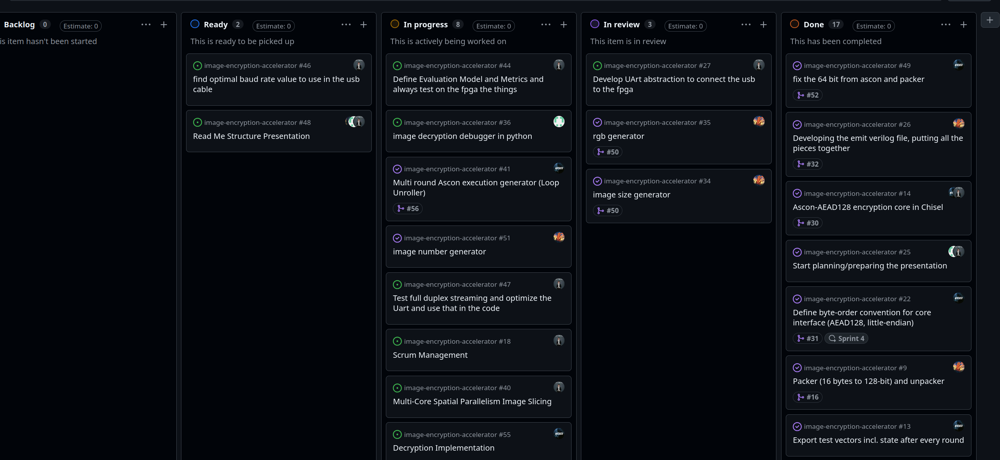

# Sprint 5

## Dates

2026-11-3 - 2026-11-10

## Management info
### Sprint Planning Meeting: 
Discussions about further implementations, evaluation model and metrics. Optimization procedures.
Read Me Structure.

### Sprint Review and Retrospective Meeting: 
Some Optimizations done but we still have work to do. For the next week the goal is to finish the optimizations

## Relevant resources

### Scrum Board at the beginning of the sprint

### Scrum Board at the end of the sprint

