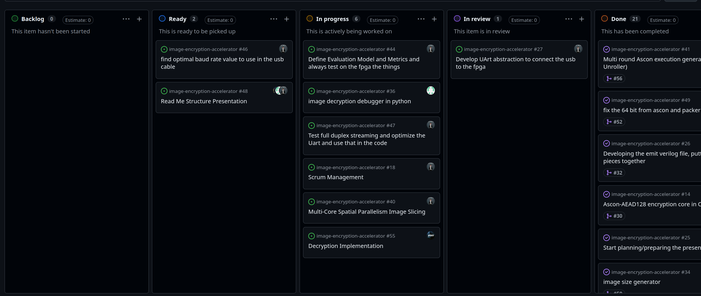
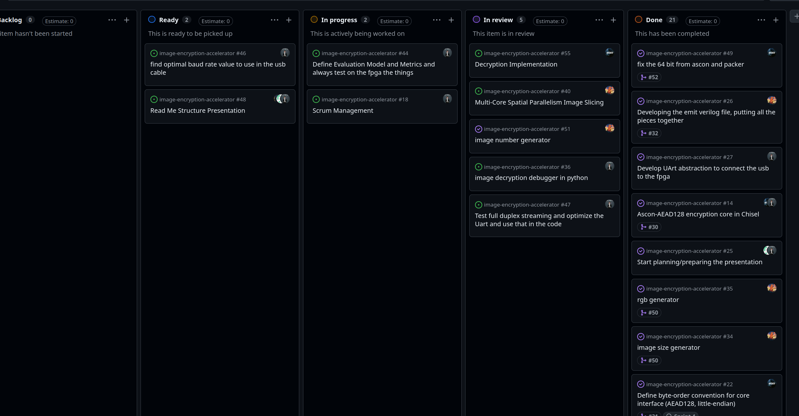

# Sprint 6

## Dates

2026-11-10 - 2026-11-17

## Management info
### Sprint Planning Meeting: 
Discussions about the results that we obtained and how to related them with performance of the fpga. Now that we concluded the "main" job we'll try to do a real time video encryption.

### Sprint Review and Retrospective Meeting: 
Optimization procedures done. Acknowledge of the metrics to use. We think that now its the time to test the optimizations on the fpga and share the results.

## Relevant resources

### Scrum Board at the beginning of the sprint

### Scrum Board at the end of the sprint

