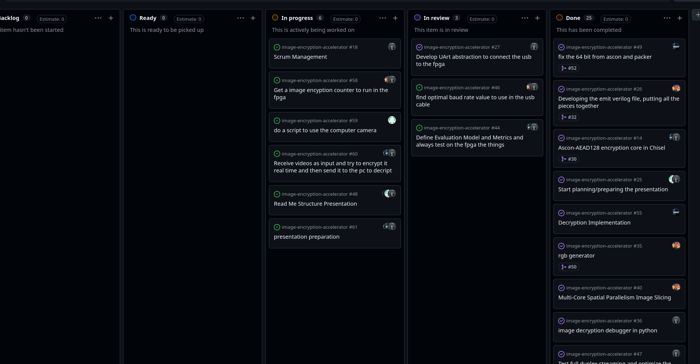

# Sprint 7

## Dates

2026-11-17 - 2026-11-24

## Management info
### Sprint Planning Meeting: 
Reflection about testing optimizations based on the metrics. Possibility of pipelining a real time video encryption since ascon only takes 128 bits per cycle. Create a image encryption counter in the fpga for debugging and for curiosity. Start thinking about the structure of the READ me and the presentation.

### Sprint Review and Retrospective Meeting: 

## Relevant resources

### Scrum Board at the beginning of the sprint

### Scrum Board at the end of the sprint

